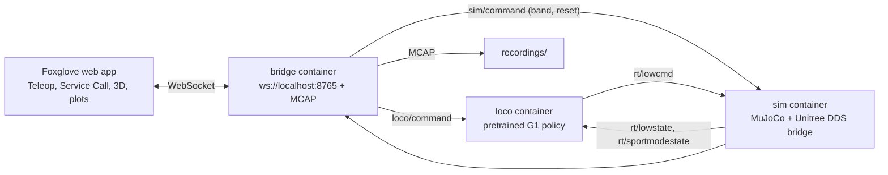

# Unitree G1 in simulation, driven from Foxglove

## Why this project uses a Unitree robot

This is a Devex proof of concept. It is not a Unitree product effort. The Unitree G1 is here because it is a convenient stand-in: Unitree publishes a MuJoCo simulator that uses the same DDS topics as the real robot, plus a pretrained walking policy, so anyone can run a legged robot from `task up` with no hardware and no license. None of the patterns below depend on the robot. They can also be evaluated with other robots.

The project demonstrates three things.

**The [Foxglove SDK](https://docs.foxglove.dev/docs/sdk/introduction) as the robot's only interface.** One Python process (`bridge`) publishes typed schemas (joint states, transforms, lidar scans, health), serves the URDF, and records the same messages to MCAP. There is no ROS graph, no rosbridge, and no custom WebSocket protocol. The live view and the recording come from the same `log()` calls, so what you debug from a file matches what you saw live.

**Remote control from Foxglove.** The operator drives the robot from stock Foxglove panels: the Teleop panel publishes velocity, Service Call buttons stand, start, pause, and damp it, and a hallway navigator can be started and interrupted the same way. On the desktop, control goes over the SDK's WebSocket server, and the headless end-to-end test talks the same protocol as the panels. With a device token, the bridge also starts the SDK's Remote Access gateway, which carries the same channels, services, and robot model through Foxglove's cloud. A phone on mobile data drives the same robot with the same buttons. It is one extra `start_gateway` call, not a second integration. The robot also protects itself: when health reaches `incident` (a fall), the bridge damps the motors once instead of letting the policy keep struggling.

**MCAP management that suits event-driven telemetry.** Telemetry and events are kept apart on purpose:

- Telemetry rolls into a new MCAP every minute, so every file is small and has a bounded time span.
- Health writes a small event MCAP for each `incident` and for each recovered run of `degraded`. The file holds the time window (30 s before an incident through 10 s after, or the whole degraded stretch plus pre-roll), the reason, and the recording it came from, and it is dated by that window.
- Foxlet, Foxglove's edge agent (`task up` starts it when `.env` has a device token), uploads the event files as soon as they appear. The telemetry is only listed in Foxglove and stays on the robot.
- A separate event trigger, not part of this repo, turns each event file into a Foxglove event and imports only the telemetry files that overlap its window.

The result is that a fall is visible in Foxglove within seconds, with the full-rate data from around it, while the hours of uneventful walking never leave the robot. Upload cost scales with the number of events, not with robot uptime. Because events are plain files with metadata, whatever writes them (health today, an operator button or a mission step later) plugs into the same trigger.

With a device token configured, recordings appear on the associated device in your Foxglove organization. Event files are imported automatically; minute-long telemetry files remain listed until an event requests the overlapping recordings.

Agent-oriented docs (architecture, decisions, interfaces) are in [`docs/README.md`](docs/README.md). Start here to run the robot.

A Unitree G1 EDU (29 dof) in MuJoCo, standing and walking under Unitree's pretrained policy, watched and driven from the Foxglove web app. This is the working benchmark: drop it from the hanging rope, walk it with Teleop, and keep the run as an [MCAP](https://mcap.dev/) under `recordings/`. Everything runs in Docker. The host needs Docker and, for the simulator window, an X11 session.

The simulator speaks the same DDS topics as the real robot (`rt/lowstate`, `rt/lowcmd`, `rt/sportmodestate`), so the Foxglove side is unchanged when a real G1 replaces it. What the simulator lacks is the robot's onboard locomotion service (`LocoClient` on the real G1). The `loco` container stands in for it with Unitree's pretrained walking policy from [`unitree_rl_gym`](https://github.com/unitreerobotics/unitree_rl_gym), the same `motion.pt` and `g1.yaml` their `deploy_real.py` uses.



All three services use the host network on DDS domain 1, interface `lo`, so they never reach a real robot on domain 0.

## Prerequisites

- Docker Engine with Compose v2, your user in the `docker` group, and [Task](https://taskfile.dev/).
- An X11 session for the simulator window (`xhost +local:docker` once per login). Headless mode needs none.
- A browser for the [Foxglove web app](https://app.foxglove.dev/). It connects to `ws://localhost:8765` because browsers treat localhost as a secure origin. The desktop app works the same way if you prefer it.

## Run

```bash
task up          # MuJoCo window, bridge, and walking policy
task foxglove    # opens the web app connected to ws://localhost:8765
```

The first time, import `foxglove/g1-layout.json` in the web app (Layouts, Import from file). The layout has the 3D view with the G1 model, pelvis height and velocity plots, the Teleop panel on `/cmd_vel`, and Service Call buttons in the order below. Any other layout shows the topics but not the robot: the 3D panel needs the URDF layer from this file, which loads `http://localhost:8770/g1_29dof.urdf` from the bridge and poses it from `/robot/joint_states` and the `world → pelvis` transform on `/tf`.

Open connection, then **Foxglove WebSocket**, and leave the address at `ws://localhost:8765`. That menu item is this process: the bridge calls `foxglove.start_server` from the [Foxglove SDK](https://docs.foxglove.dev/docs/visualization/connecting/live). It is not Rosbridge and not a ROS graph. **Remote Access** in the same dialog is also the SDK (`foxglove.start_gateway`), reached through Foxglove's cloud with a device token. Foxglove recommends Remote Access when the robot is off your network, and the direct WebSocket when you are on the same machine and want every message. Both SDK entries are current. The deprecated path is a hand-rolled server on the old `foxglove.websocket.v1` protocol.

### From a phone, or any machine that is not this one

With `FOXGLOVE_DEVICE_TOKEN` in `.env`, `task up` starts the gateway beside the local server. The bridge log prints `remote access connected`. Then:

1. On the phone, sign in to your Foxglove organization in the browser, open the device associated with your token, and choose to visualize it live. Or use Open connection, **Remote Access**, and select that device (named `g1-sim` by default).
2. When you can see the robot, import `foxglove/mobile-field-operator.json` and select it. It is two full-width color bars, health and navigation, then the four stand-up buttons, Pause, Resume, and a large Teleop. The bars are the only subscriptions: one word each, painted across the panel. There is still no robot, no scan, and no joint states.
3. When you cannot see the robot, import `foxglove/g1-mobile-layout.json` instead. It adds the robot, following the pelvis, and a health strip. It still skips the lidar fan, the plots, and the raw messages. Damp, reset, and the hallway buttons stay on the full layout.
4. `foxglove/g1-remote-layout.json` is the full layout with the URDF loaded as `package://g1_description/g1_29dof.urdf`, which the gateway serves. Use it on a desktop that is not this machine. The phone cannot reach `http://localhost:8770`, so the local layout shows everything except the robot model there.
5. Teleop publishes `/cmd_vel` through the gateway. The buttons are the same services as above.

The Foxglove WebSocket on the desktop keeps working at the same time. Both connections drive one robot, and the last Twist wins. `task e2e` and `task e2e-hallway` clear the token, so they never start a gateway.

The robot starts hanging limp from a virtual rope, the way Unitree's own simulator starts humanoids. Motors are off in this state, so it dangles and turns like a puppet until step 1; the rope damps that swing rather than gravity. Stand it up:

1. **Stand** (`loco/stand`): two-second ramp of every joint to the policy's default pose, still hanging.
2. **Start policy** (`loco/start`): the walking policy runs at zero velocity. It has to be balancing before the feet take any weight; a robot holding a fixed pose topples as the rope slackens.
3. **Band lower 0.1 m** (`sim/band_lower`), seven times: the pelvis comes down from about 1.28 m; the feet touch at about 0.8 m and the rope is slack after the seventh step. Watch the height plot.
4. **Release band** (`sim/band_release`): the rope is gone. The robot is standing on its own.
5. Drive with the **Teleop** panel: up and down are ±0.4 m/s forward, left and right are ±0.6 rad/s yaw. Releasing a button stops the stream and the controller zeroes the velocity after 0.5 s. The policy clamps to its training range, 0.8 m/s forward, 0.5 m/s sideways, 1.57 rad/s.

**Pause** (`loco/pause`) keeps the robot balancing in place and ignores Teleop. **Resume** (`loco/resume`) lets Teleop drive again. **Damp** (`loco/damp`) is motors off: zero stiffness, and the robot collapses. **Reset sim** (`sim/reset`) puts the robot back on the rope at the start pose; call Damp first so the controller is not fighting the reset. **Band raise** and **Band attach** undo the two band buttons. Checking Pause by hand is in [docs/operations.md](docs/operations.md#validate-pause-and-resume).

In the MuJoCo window, keys `7`, `8`, `9` shorten, lengthen, and toggle the rope as well.

### Same sequence from a script

The e2e uses a small Foxglove WebSocket client that does exactly what the panels do. With `task up` running:

```bash
docker compose run --rm --no-deps --entrypoint python bridge -m unitree_foxglove.ws_client
```

It stands the robot up, releases the rope, drives forward for four seconds, and stops.

## Walk the hallway

The open floor is the default world. Two closed hallways exist for navigation, 2 m wide with 2 m walls, and the robot starts 1 m from the near end:

```bash
task hallway                   # 10 m hallway
task hallway WORLD=hallway20   # 20 m hallway
```

The walls appear in the 3D panel on `/world/scene`, and a 72-ray planar lidar on the torso draws its returns on `/scan`, coloured by range. Stand the robot up as above (steps 1 to 4), then press **5. Walk the hallway** (`nav/start`). The navigator has no map. Every 0.1 s it finds the dominant wall direction in the scan, treats that as the corridor axis, picks the more open end once, turns to face it, and walks it while steering to the midpoint between the side walls. It slows below 3.5 m from the end wall and declares `arrived` about 1 m in front of it. The `nav` Indicator and the `/nav/state` message on the right show `aligning`, `walking`, `arrived`, `blind` (no scan), or `stopped` (you pressed **Stop navigating**, touched Teleop, changed a loco mode, or health reported an incident). The policy keeps balancing on arrival; Teleop drives again.

The pretrained gait covers ground faster than it is asked to and drifts in yaw at zero command, so the walk is not a straight line. The navigator corrects for that. It cannot correct a fall: when health reaches `incident` navigation stops and the motors damp, so the policy stops kicking. Reset and stand it up to try again.

Headless:

```bash
task e2e-hallway                   # 10 m hallway, at least 6 m of travel
task e2e-hallway WORLD=hallway20   # 20 m, at least 15 m
```

That run passes when the last `/nav/state` is `arrived`, the base never dropped below 0.5 m, health never reported `incident`, and the recording under `recordings/e2e-hallway/` holds `/scan`. The gait falls on some runs; that is the same instability `task e2e` sees, not a navigation fault, and the MCAP shows where it happened.

## What is recorded

`bridge` writes `recordings/g1-<UTC>.mcap` for each run and serves the same channels live:

| Topic | Message | Contents |
| --- | --- | --- |
| `/robot/joint_states` | JointStates | 29 joints in Unitree motor order: legs, waist, arms |
| `/robot/base_pose` | PoseInFrame | position from `rt/sportmodestate`, orientation from the IMU |
| `/tf` | FrameTransforms | `world → pelvis`, the same pose, for placing the URDF |
| `/robot/base_velocity` | Vector3 | linear velocity of the base |
| `/robot/imu_gyro`, `/robot/imu_accel` | Vector3 | rad/s and m/s² |
| `/cmd_vel` | JSON | every Twist the app sent |
| `/loco/mode` | JSON | `damp`, `stand`, `walk`, or `paused`, whenever it was requested |
| `/health/state` | JSON | `nominal`, `degraded`, `incident`, `inactive`, or `offline`, with a reason ([docs/health.md](docs/health.md)) |
| `/scan` | LaserScan | 72-ray planar lidar from the torso, 10 Hz, posed in `world` |
| `/world/scene` | SceneUpdate | the hallway walls, once a second; absent in the open world |
| `/nav/state` | JSON | navigator state, commanded `vx`/`wz`, clearance ahead, left, right, and heading |

A run in which the robot fell also gets a tiny file `recordings/events/g1-<UTC>-incident-<UTC>.mcap`. A bump that recovers, without falling, gets `g1-<UTC>-degraded-<UTC>.mcap` once health has stayed out of `degraded` for 3 s. Each file holds the time window as metadata and as two messages, so Foxglove dates it on that window rather than 1970. With a device token in `.env` (see `.env.example`), `task up` runs Foxlet and those files upload to the device associated with your token automatically. This repo does not call the Foxglove API. Telemetry rolls every 60 s and stays on the device until an event asks for the minutes that overlap it. See [docs/health.md](docs/health.md#incident-events).

Open the MCAP in Foxglove like any local file to review a run next to what was asked of the robot. The URDF layer needs the bridge running for the model; the plots and raw messages do not.

## Checks

```bash
task test          # unit tests inside the image
task e2e           # headless walk that must stay up, then a fall that must write an event MCAP
task e2e-hallway   # headless navigator must reach the end of the hallway
```

These tasks reuse the existing `unitree-foxglove:local` image. To build first,
use `task test:with-build`, `task e2e:with-build`, or
`task e2e-hallway:with-build`. Builds use Docker's normal cache. Rebuild after
changing source, tests, or dependencies, since tests run the code baked into the
image. A missing image produces an instruction to build it. Direct e2e script
invocations also reuse the existing image.

`task e2e` has two phases. The walk passes when the base travelled at least 0.3 m and never dropped below 0.5 m, and health never reported `incident`. A fall there fails it; open that MCAP in Foxglove to see why. The second phase releases the robot without the walking policy and passes when health reaches `incident` and one small file appears under `recordings/events/`. The simulator's real-time factor should read `1.00`.

## CI and review artifacts

GitHub Actions runs the same developer tasks: `task ci:unit` for unit tests and
lint, and `task ci:fall` for deliberate-fall incident recording. A separate
**Locomotion benchmarks** workflow runs `task ci:walk` and `task ci:hallway`,
keeping documented gait failures visible.

For a quick result, open the Actions run's **Summary** or a named **test results**
check on the commit/PR. These show pass/fail/skip counts, test durations, and
failure details. Simulation reports separate image build, acceptance, and replay.
Comparisons appear once earlier published results are available; the first report
establishes a baseline.

Download a run's artifacts for JUnit reports, telemetry and event MCAPs, replay
screenshots, command/Compose logs, and asciinema terminal casts. Artifacts are
retained for 14 days and uploaded even on failure. See
[CI details and local reproduction](docs/operations.md#continuous-integration).

## Go2

`UNITREE_ROBOT=go2 task sim` opens the quadruped instead. `unitree-stand` sends its stand-up trajectory over `rt/lowcmd`. The walking policy is G1-only, so `loco` exits for other robots.

## Layout

Upstream Unitree code is pinned as submodules and not modified:

- `third_party/unitree_mujoco` — MuJoCo scenes and the Python DDS bridge
- `third_party/unitree_sdk2_python` — DDS types and the CycloneDDS client
- `third_party/unitree_rl_gym` — the pretrained G1 policy, its deploy config, and the 29-dof URDF with meshes (BSD-3; only those files and the licence go into the image)

`src/unitree_foxglove/`:

- `sim.py` — loads the scene, hosts the upstream bridge, adds the rope and the `sim/command` topic. The motor PD loop runs inside the physics step from current sensors, as motor firmware does, because the upstream bridge's one-shot torque on stale sensors diverges with the G1 gains.
- `worlds.py` — the hallway worlds and the lidar fan, added to the upstream scene with `MjSpec` at load time, so the scene files stay untouched.
- `nav.py` — the hallway navigator: one scan in, one velocity command out, no map. `NavController` runs it against the same `LocoBackend` Teleop uses.
- `loco.py` — the policy controller: damp, stand, and walk on the `loco/command` topic.
- `bridge.py` — the Foxglove server (Teleop input, services) and the MCAP writer. `LocoBackend` is the seam for a real robot: `SimLocoBackend` publishes DDS to `loco`; a `LocoClient` backend would call `Damp`, `StandUp`, `Start`, `Move`.
- `assets.py` — the HTTP server for the URDF and meshes (port 8770, `ASSETS_PORT`), with the CORS header the web app needs.
- `robots.py` — `go2` and `g1` profiles (DDS types, scene, joint names, URDF).
- `ws_client.py`, `check_mcap.py` — the e2e client and the recording check.

## Towards a real G1 EDU

Nothing in the navigator or the Foxglove side knows it is talking to a simulator. Taking the hallway walk to a physical G1 EDU means replacing two seams and leaving the rest:

- **Locomotion.** `G1LocoClientBackend` in `bridge.py` names the mapping onto Unitree's `LocoClient` (`Damp`, `StandUp`, `Start`, `Move`), on DDS domain 0 and the robot's network interface instead of domain 1 on `lo`. `NavController` calls `move(vx, vy, wz)` on that backend the same way it calls the simulated one.
- **Scan.** The G1 EDU carries a Livox Mid-360. A small process would reduce its point cloud to one planar `LaserScan` at torso height and publish it on `sensor/scan` with the pose it was taken at, which is all the navigator reads. The sim publishes exactly that message from its rangefinder fan.

The stand-up buttons and the rope do not apply on the robot; the operator uses Unitree's own stand. Speeds in `NavParams` were tuned against a gait that overshoots its command, so expect to raise `cruise_speed` and lower `stop_distance_m` once the real gait tracks velocity. This is not implemented here; the boundary in [docs/overview.md](docs/overview.md#boundaries) still holds.

## Notes

- The log may say Mesa failed to load the `iris` driver. The window still opens through the host X server. This machine's NVIDIA driver is not in use; the simulation runs in real time on the CPU.
- `unitree_sdk2py` pins `cyclonedds==0.10.2`, whose newest wheel is for CPython 3.10, so the image installs Python 3.10.
- The policy was trained on the legs; the waist and arms are held at zero with the gains from `g1.yaml`. Expect some drift at zero command.
